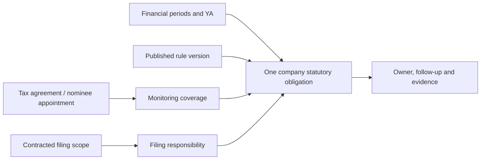

# Deadline rules and compliance monitoring implementation plan

**Status:** Draft for product review; implementation has not started.  
**Date:** 27 September 2026.  
**Scope:** Simplify deadline configuration; correct period-based corporate-tax planning; persist monitoring of obligations handled by clients or other providers; support nominee-director oversight across applicable statutory obligations.

## 1. Intended outcome and decisions

Maintain one company record for each statutory obligation and filing period. Separately record who performs the filing, why Oakcloud tracks it, and who within Oakcloud follows up. A deadline continues to exist when the filing provider changes.

Confirmed by the user:

- A corporate-tax engagement monitors applicable **corporate-tax** deadlines from the agreement date, including periods outside Oakcloud's filing engagement.
- A nominee-director engagement monitors **all applicable statutory deadlines**, even where Oakcloud is neither the secretary nor the tax agent.
- ECI and annual corporate income tax returns need understandable, ready-to-use rules, with FYE and YA visible.

Proposed defaults, still open to adjustment:

| Decision | Draft recommendation |
|---|---|
| Obligations overdue before monitoring starts | Include unresolved items in an onboarding takeover review; distinguish them from deadlines arising during our monitoring coverage. Do not declare a filing overdue merely because historical completion evidence has not yet been supplied. |
| Client reminders | Prepare reminders for staff review and sending. Automatic external sending is a later configurable policy, not assumed permission. |
| End of monitoring | Explicit monitoring end/handover date. For a single-period tax engagement, propose review after the last contracted filing is verified; do not silently stop at FYE, a billing end date, or an operational service end date. |
| Reminder cadence | Initial configurable proposal: 60, 30, 14 and 7 days before due date, then overdue escalation. Consolidate reminders and suppress repeats according to recorded activity. |
| Forward visibility | 24 months for company statutory obligations, plus every explicitly contracted filing period even when its due date is later. Retain existing service/billing horizons. |

This is a software/product design. Official sources substantiate the tax examples below; proposed monitoring intervals, evidence handling and escalation are Oakcloud workflow choices.

## 2. Required behaviour using the user's example

Assume an established company with an unchanged 31 March FYE, a normal annual basis period, no applicable filing waiver, an agreement dated **1 April 2026**, and an engagement to prepare both tax filings for **FYE 31 March 2026 / YA 2027**. The agreement date is illustrative; the user's actual date was not supplied.

| Due date | Company obligation | Financial period / YA | Filing responsibility | Oakcloud action |
|---|---|---|---|---|
| 30 June 2026 | ECI | FYE 31 March 2026 / YA 2027 | Oakcloud, if included in the engagement | Prepare, file and record evidence |
| 30 November 2026 | Annual corporate income tax return | FYE 31 March 2025 / YA 2026 | Client / previous provider / unconfirmed | Confirm responsibility, remind and obtain filing evidence |
| 30 November 2027 | Annual corporate income tax return | FYE 31 March 2026 / YA 2027 | Oakcloud, if included in the engagement | Prepare, file and record evidence |

The YA 2026 return is a **separate obligation**, not an additional deadline for FYE March 2026. It remains visible because its due date falls within monitoring coverage. Under the normal mapping, the YA follows the year in which the financial year ends, and the annual return is due on 30 November of that YA. [IRAS basic corporate-tax guide](https://www.iras.gov.sg/taxes/corporate-income-tax/basics-of-corporate-income-tax/basic-guide-to-corporate-income-tax-for-companies).

ECI is generally required within three months of FYE, subject to the filing waiver and specific exclusions. [IRAS ECI guidance](https://www.iras.gov.sg/taxes/corporate-income-tax/estimated-chargeable-income-%28eci%29-filing).

These three rows are the minimum demonstration, not an exhaustive recurring calendar. If tax monitoring continues into 2027, ECI for FYE March 2027 must also appear when applicable, with responsibility unconfirmed unless separately contracted. A one-year engagement must not imply Oakcloud files every future YA.

Additional acceptance examples:

- If the agreement starts **1 September 2026**, the November 2026 and November 2027 returns are covered. June 2026 ECI is shown for takeover review (2026-09-28: Scofield set the ECI lookback to 3 months before the service start; tax returns keep 12 months, and tax returns from the service's engagement start YA are engaged work at any age rather than takeover review; ECI never reaches back); if expressly contracted, it is also retained as delivery work requiring filing-status confirmation.
- If an April agreement is only activated in September, June ECI is a covered historical obligation. Activation date must not erase it. Flag missing filing evidence rather than asserting a known failure to file.
- If the agreement starts **1 December 2026**, the November 2026 return belongs in earlier-obligation review, rather than being described as due during coverage.
- A company incorporated in 2026 does not automatically get a YA 2026 obligation simply because an engagement references YA 2027. Incorporation, commencement and actual period facts control applicability.

## 3. Current implementation and what to preserve

Repository inspection found useful foundations, alongside important limitations:

| Current area | Observation | Planned treatment |
|---|---|---|
| `src/services/deadline-rule/starter-drafts.ts` | `SG_FORM_C` already uses 30 November in FYE year + 1. `SG_ECI` requires a user-entered `monthsAfterFye`. | Preserve rule codes; publish reviewed presets that supply statutory constants and explicit period semantics. |
| `src/services/service-schedule/` | Pure evaluator, validated expression language, date-only helpers, applicability and calculation explanations exist. | Extend this engine; do not create a second calculator. |
| `src/services/schedule-reconciliation/projection.ts` | Canonical projection is shared by operational preview and reconciliation. | Extend its period planning and reuse it for all new previews. |
| `planner.ts`, `company-source.ts`, `evaluator.ts` | Annual planning reconstructs FYE from company month/day and aligns it to a current rolling period. It lacks actual financial/tax periods. | Plan by obligation period and due date, including prior-FYE obligations due after monitoring starts. |
| `prisma/schema.prisma`: `ServiceCycle`, `DeadlineOccurrence` | Both require a client service; uniqueness is service/cycle based. | Add company ownership for canonical statutory occurrences and links to multiple coverage sources. |
| `deadline-reconciler.ts` | Ending a service can cancel future open generated deadlines. | End the relevant delivery/coverage link; retain the company statutory obligation. |
| `src/services/deadline/awareness.ts` | Existing prior-YA and nominee alerts use name regexes, inferred YA and a separate hardcoded calendar. They have synthetic IDs and a 90-day lookback / 370-day lookahead. | Replace calculation heuristics with persistent canonical obligations; retain useful alert explanations during transition. |
| `src/components/services/admin/deadline-rule-form.tsx` | The main form exposes recurrence, predicates, parameter keys, source keys and generic operations. | Make approved presets and plain-language configuration primary; retain advanced authoring. |
| Queue, rule impact and occurrence services | Leases, retries, audit, impact fingerprints, tenant/company permissions and protected-history handling already exist. | Reuse and expand these safeguards. |

The awareness feature already acknowledges these business needs, but cannot serve as the durable tracker. A same-YA service or matching date is not proof that someone has accepted responsibility or completed a filing. Rename-based classification is also unsuitable as a permanent coverage policy.

## 4. Domain model and rule ownership

Keep the following concepts separate:

| Concept | Meaning |
|---|---|
| Obligation definition | What must be done, to which authority, when, and under what conditions |
| Financial/tax period | The actual accounts/basis period and YA to which an obligation belongs |
| Company obligation | One persisted statutory deadline for one company and period/event |
| Monitoring coverage | Why Oakcloud must track it, from when, until when, and under which agreement/appointment |
| Delivery scope | The exact obligations and periods Oakcloud has agreed to perform |
| Filing responsibility | Oakcloud / client / external provider / unconfirmed, with confirmation history |
| Internal accountability | Monitoring owner and, where relevant, delivery owner |
| Compliance evidence | Reported filing, verified filing, exemption, extension or outstanding verification |
| Follow-up | Reminder/contact history, next action date and escalation |

“We file” and “We monitor” are derived views. They are not mutually exclusive states: a nominee director can monitor a deadline that Oakcloud's tax team is filing.

### 4.1 Proposed persistence changes

Use additive migrations. The following are proposed model responsibilities; finalize exact Prisma names during the first implementation work package.

1. **Company financial periods and tax assessments.** Persist actual start/end dates, stable IDs, YA, provenance, confirmation state and revisions. Financial periods and YA cannot be assumed one-to-one: basis segments must permit one accounts period spanning multiple YAs and multiple segments assigned to one assessment. Keep Company FYE day/month as the recurring preference, not the historical record. Do not repurpose the existing accounting `ReconciliationPeriod` without establishing matching domain semantics.
2. **Company monitoring coverage.** Store tenant/company, profile, agreement/service or confirmed nominee appointment reference, monitoring start/end, start-date provenance, owner and policy. Coverage is independent of a billable service. Multiple coverage records may overlap without duplicating deadlines.
3. **Explicit service delivery scope.** Link a client service to named obligation types and selected financial/tax periods. ECI and the annual tax return can be independently included. Ambiguous legacy scope stays unconfirmed.
4. **Extend existing cycles and occurrences.** Introduce a typed `SERVICE` / `COMPANY` ownership scope. Company statutory cycles use actual obligation periods and may have no `clientServiceId`; service/client/internal deadlines retain their existing ownership. Keep the existing occurrence lifecycle and mutation service as the canonical action boundary.
5. **Coverage links and responsibility history.** Link each company occurrence to every relevant coverage record. Store its filing party, optional delivery service/provider contact, internal owner, confirmation actor/date and change history. A provider name alone is not an accepted engagement.
6. **Evidence and follow-up records.** Store structured filing reports, verified outcome, waiver/extension basis and reminder activity. Reuse existing attachment/document and task-resource boundaries for files and follow-up tasks. Add durable review issues for missing applicability inputs or dates, which cannot be represented by a deadline row requiring a non-null due date.

Database invariants:

- Canonical statutory identity is `(tenant, company, obligationCode, obligationPeriodIdentity, milestone/scheduleIdentity)`. For the annual corporate-tax return, the normal period identity is YA; ECI uses the reviewed assessment/filing-period identity. Irregular cases must declare their identity explicitly.
- Exclude due date, provider, agreement, client-service ID and rule-version ID from canonical identity. Edits to these values must not create another obligation.
- Preserve existing service-cycle uniqueness. Add partial unique indexes for company statutory ownership, rather than applying statutory deduplication to all custom deadlines.
- Composite tenant/company foreign keys and ownership checks prevent cross-tenant or cross-company period, coverage, contact and occurrence links. Nullable service IDs must not remove ownership integrity.
- Conflicting delivery assignments create a review issue. Do not pick one silently or use monitoring precedence to infer the filer.
- The canonical record owns progress and evidence. Delivery/monitoring links cannot maintain competing completion states.

The canonical `obligationCode` is governed metadata distinct from a tenant's editable rule name or code. Explicitly map legacy/custom definitions to it where appropriate; definitions without a confirmed mapping remain separate pending review. Resolve the applicable rule/version deterministically for each period. Two active definitions claiming the same obligation and period create a conflict, not a last-writer-wins update.

Applicability facts also need effective dates or period-specific snapshots: GST registration, employer status, entity category, dormancy and exemptions can change. Historical backfill uses the facts applicable to that period/event. Missing historical facts create review issues rather than projecting today's company profile backwards.

## 5. Draft Singapore corporate-tax rules

### 5.1 ECI — keep stable code `SG_ECI`

| Rule field | Draft definition |
|---|---|
| Display name | Estimated Chargeable Income (ECI) |
| Authority / type | IRAS / statutory |
| Period | Reviewed financial period and associated YA/basis mapping |
| Standard date | Within three months after FYE; approved month-end cases use the last day of the third following month |
| User setup | Select/confirm the financial period; do not ask normal users how many months after FYE |
| Applicability | Required unless the relevant period satisfies a documented waiver or exclusion |
| Unknown facts | Keep a visible review item and calculated candidate deadline; do not infer exemption |
| Calendar adjustment | No generic weekend/holiday shift; any authority-approved exception requires its own supported rule or recorded extension |

The standard ECI waiver requires both annual revenue at or below S$5 million and nil ECI. Record that assessment per relevant period, with source, reviewer and date; absence of figures must not evaluate as zero. Keep waiver evidence distinct from filing evidence. [IRAS ECI guidance](https://www.iras.gov.sg/taxes/corporate-income-tax/estimated-chargeable-income-%28eci%29-filing).

The existing `addMonthsClamped` is insufficient for the approved month-end cases: 30 September plus three clamped months is 30 December, while IRAS lists 31 December for September FYE. Add an explicit month-end date operation/policy in the shared engine, versioned and scoped to rules that require it. Do not change generic month arithmetic used by billing. Published quarter-end checks include March → 30 June, June → 30 September, September → 31 December and December → 31 March. [IRAS due dates](https://www.iras.gov.sg/due-dates).

Before publishing the preset, review all twelve month-end examples and leap-year cases against authoritative guidance. Non-month-end FYE, changed FYE and long/short first accounts must go through reviewed period mapping; do not assume the normal month-end formula answers every exceptional case. Store an approved date when a case needs manual determination.

### 5.2 Annual corporate income tax return — keep stable code `SG_FORM_C`

| Rule field | Draft definition |
|---|---|
| Display name | Corporate income tax return — Form C / C-S / C-S (Lite) |
| Authority / type | IRAS / statutory |
| Period | Explicit Year of Assessment, linked to the relevant basis-period segments |
| Standard date | 30 November of the YA |
| Normal YA suggestion | Financial period end year + 1, subject to confirmation of normal period treatment |
| User setup | Show FYE and suggested YA together; ask for confirmation only when facts are missing or inconsistent |
| Form selection | An attribute of the same annual filing obligation, not three separate deadlines |
| Applicability | Determine separately from ECI; a valid ECI waiver does not waive this return |

IRAS's 2026 filing guidance confirms the 30 November 2026 deadline for YA 2026 and distinguishes the available return forms. [IRAS filing season 2026](https://www.iras.gov.sg/taxes/corporate-income-tax/basics-of-corporate-income-tax/corporate-income-tax-filing-season-2026).

Dormancy does not itself remove annual filing: record the applicable dormant-company form or an actual filing waiver. [IRAS dormant-company guidance](https://www.iras.gov.sg/taxes/corporate-income-tax/dormant-companies-or-companies-closing-down/dormant-companies).

For new companies or accounts spanning multiple YAs, support explicit basis allocation and reviewed filing dates; do not force the normal mapping. Preserve original period facts when the company's recurring FYE later changes. [IRAS basic corporate-tax guide](https://www.iras.gov.sg/taxes/corporate-income-tax/basics-of-corporate-income-tax/basic-guide-to-corporate-income-tax-for-companies).

### 5.3 Preset governance

Version each approved preset with jurisdiction, authority, official source URL, reviewed date, reviewer, required inputs, effective-period selection and example fixtures. Rule-version selection must specify whether a revision applies by YA, basis-period end or event date. Publishing a new version must not rewrite older completed filings.

Keep published/custom tenant rules intact. Offer impact-reviewed upgrades for existing ECI/Form C rules; do not rely on the existing untouched-starter repair to upgrade published configurations. Explain affected companies, deadlines, exemptions, missing inputs and protected records before publication.

## 6. Coverage, planning and reconciliation

### 6.1 Monitoring dates and activation

- Once an agreement is activated through the existing signed/manual activation boundary, tax monitoring defaults to the recorded **agreement date**, independently of service start, FYE, YA, signing timestamp and activation timestamp.
- Draft agreements show a preview only. A late activation backfills the approved coverage interval; it does not pretend that reminders were sent before activation.
- For nominee work, also record the actual appointment and cessation dates. An earlier appointment than the agreement date produces a review item and must not leave an unnoticed coverage gap. Recommend coverage from the earlier confirmed appointment/agreement monitoring commitment.
- Manual onboarding requires an explicit monitoring start and reason. Unknown agreement dates require review, not a silent default to today.
- A paused delivery service does not automatically pause compliance monitoring. Changes to start/end dates require a fresh impact preview and audit.

### 6.2 Canonical algorithm

1. Load tenant/company facts, confirmed periods, published definitions, coverage intervals, delivery scopes, responsibility/evidence and existing occurrences.
2. Resolve applicable obligation families from typed coverage profiles. Tax selects corporate tax; nominee selects the company's statutory inventory. Use explicit catalog metadata, not service-name regexes.
3. Enumerate actual candidate periods/events whose due dates can fall within coverage, including earlier FYE periods. Add all contracted delivery periods regardless of the rolling horizon. For missing historical facts, create durable review issues or clearly provisional candidates.
4. Evaluate using the shared date/applicability engine against the selected period. Explicit period FYE must not be realigned to a future anniversary by the legacy annual-landmark behaviour.
5. Include a candidate when its statutory/approved extended deadline falls in any monitoring interval, when delivery scope explicitly includes it, or when accepted takeover review includes it. Start/end boundaries are inclusive. Track the reason for each inclusion.
6. Upsert by stable company obligation identity and attach all coverage reasons. Resolve filing responsibility independently. Unknown applicability or ownership is a visible gap, not a dropped row.
7. Preserve protected history and merge follow-up state without resetting it. Ordinary rules may recalculate future open, generated, non-overridden dates; corrections to protected historical dates use the existing style of explicit fingerprinted remediation.
8. Return the same results to preview and apply, including period, YA, date explanation, responsibility, coverage reasons and review warnings.

Generation horizon limits creation work, not retention. Existing unresolved rows do not disappear when they become old. Process backdated coverage in bounded, resumable batches with a durable cursor and visible incomplete-coverage state; never silently truncate an old agreement to 90 days or the most recent year.

Use a 24-month future horizon for company statutory monitoring and include all explicitly selected contracted periods even beyond it. A March 2026 engagement must show November 2027 immediately. Display projected/unconfirmed future periods clearly; an unverified assumption must not produce an automatically sent definitive filing instruction.

### 6.3 Ending, transferring and extending coverage

- Ending a tax service releases its delivery assignment and/or coverage link according to a reviewed handover. It does not cancel the underlying statutory obligation.
- If a nominee relationship remains, its coverage continues on the same obligation and identifies a replacement filer or an ownership gap.
- If all monitoring ends, preserve the historical obligation, evidence and handover record. Stop routine future reminders according to the explicit coverage end; leave unresolved handover issues assigned internally. Do not mark statutory compliance completed or waived.
- Offboarding must review contracted filings due after the proposed end date, not abandon them automatically. Nominee monitoring end must consider confirmed cessation rather than merely the last invoice.
- A statutory date extension retains the original date, authority/evidence and approved operative date. An internal follow-up date never moves the statutory deadline.
- Monitor inclusion must consider an approved extension that moves a deadline into coverage; if an extension moves a retained obligation past coverage end, require handover review rather than silently dropping it.

### 6.4 Worker and billing boundary

Extend the existing reconciliation worker with a company-obligation branch. Today company/rule/tenant dispatch resolves to client services, and the service branch runs deadline and billing reconciliation together. New company monitoring must reuse queue leases, idempotency and auditing while producing **zero fee lines, billing occurrences or billing-coverage issues**.

Enqueue on coverage activation/change, delivery-scope change, relevant period/company facts, nominee appointment/cessation, approved rule/calendar revisions and rolling-horizon refresh. Expand rule impact and archive previews to include company coverage even where no client-service rule association exists. Missing configuration or a rule archive must create a coverage issue rather than erase an applicable statutory obligation.

## 7. Nominee-director statutory inventory

Nominee coverage is a relationship with Oakcloud/its appointed nominee, not an inference that every company with any nominee must be managed by Oakcloud. Capture the actual appointment provenance and agreed monitoring owner. Nominee directors have the same legal obligations as other directors; broad oversight is therefore meaningful even with external filing agents. [Ministry of Finance explanation](https://www.mof.gov.sg/news-resources/newsroom/second-reading-speech-by-second-minister-for-finance-ms-indranee-rajah-on-the-corporate-service-providers-bill-and-the-companies-and-limited-liability-partnerships-miscellaneous-amendments-bill-in-parliament-2-july-2024/).

Create a reviewed company compliance inventory, rather than treating the four current awareness candidates as exhaustive:

| Category | Required treatment |
|---|---|
| ECI and annual corporate income tax return | Period/YA rules described above; include waiver review and tax notice/payment deadlines where applicable |
| Annual return, AGM and financial statements | Applicable entity category, financial period, AGM exemption/dispensation and approved extensions; preserve authoritative dates only for their identified period |
| GST | Registration status and actual prescribed accounting periods; filing and payment tracked separately when needed |
| Employer and payroll obligations | Profile questions for employer status and applicable filing/contribution duties; reviewed templates or monitored explicit dates |
| Registers and event-driven filings | Relevant company changes, director/secretary changes, controller/nominee register duties and their triggering events |
| Other company-specific obligations | Licence renewals, regulatory notices and sector obligations identified at onboarding; explicit owner, authority, event/date and review cycle |

Annual-return and AGM requirements depend on company circumstances; the current AGM calculation of one month before `accountsDueDate` must not become a universal legal rule. [ACRA annual-return requirements](https://www.acra.gov.sg/manage/companies/legal-requirements-common-offences/filing-annual-returns-companies/deadline-requirements/), [ACRA AGM guidance](https://www.acra.gov.sg/manage/companies/legal-requirements-common-offences/holding-annual-general-meetings/).

GST due dates use prescribed accounting periods, and changes to company FYE do not automatically change those periods. [IRAS GST responsibilities](https://www.iras.gov.sg/taxes/goods-services-tax-%28gst%29/basics-of-gst/responsibilities-of-a-gst-registered-business), [IRAS changing GST periods](https://www.iras.gov.sg/taxes/goods-services-tax-%28gst%29/other-services/changing-gst-accounting-periods). Nominee-register obligations also need their own event-based definitions. [ACRA nominee-register guidance](https://www.acra.gov.sg/manage/companies/legal-requirements-common-offences/maintaining-local-companys-information-registers/rond-rons/).

Full automatic calculation can be delivered by family, but monitoring must not silently omit unsupported families. Provide explicit-date statutory entries through the canonical company workflow and an unresolved-inventory queue until a reviewed template is available. Events not yet known cannot have invented due dates: assign a recurring change-confirmation action. A nominee portfolio cannot be labelled fully covered while applicability, dates or statutory families remain unreviewed.

Implement explicit-date entries by extending the existing manual-cycle action service to company ownership, backed by a reviewed generic manual statutory rule/version and an explicit obligation/event identity. This satisfies required cycle/rule-version relations without a dummy service. Record authority, event, date source and reason; retain manual-origin protection and zero billing effects. Later adoption of an automated template links through the same identity after reviewed matching.

## 8. User experience

### 8.1 Rule administration

Primary flow: **Choose a preset → confirm applicability/required information → preview examples and impact → publish**.

Show descriptions such as “ECI: within three months after this financial year ends” and “Corporate income tax return: 30 November of the YA”. Keep source/review details available. Normal users edit company facts, filing periods, responsibility and reminders; they do not edit statutory constants to accommodate a client.

Provide a compact advanced editor for custom deadlines and existing expressions. Use selected references rather than free-text source keys where possible. Unknown/custom expressions must round-trip unchanged; a simplified editor must not discard features it cannot represent.

### 8.2 Agreement and company setup

Reuse the agreement item editor and shared operational-service form:

1. Confirm actual financial period and YA; show a plain explanation of the mapping.
2. Select the filings Oakcloud performs, including ECI and annual return independently.
3. Show monitoring start and scope, with the date's source and any earlier appointment gap.
4. Present all relevant obligations, including older-period deadlines due after monitoring starts and earlier unresolved items for review.
5. Confirm filer, monitoring owner and evidence status; allow “Unconfirmed” with an assigned follow-up instead of forcing an invented answer.
6. Save through the existing preview/fingerprint and activation boundaries.

Capture the agreed filing scope and monitoring commitment in the agreement item's versioned snapshot before signing, then copy that accepted scope through activation. Later operational responsibility changes require an audited amendment/handover; they must not silently rewrite a signed agreement or imply additional contracted work.

Example preview columns: **Obligation | FYE / YA | Due date | Who files | Our follow-up owner | Why tracked | Status / next action**. Avoid “out of scope” alone: use “Outside our filing engagement; we monitor”.

### 8.3 Daily deadline workspace

- One row per company obligation, with multiple coverage badges such as “Tax engagement” and “Nominee director”.
- Saved views: We file; Client/other provider files; Responsibility unconfirmed; Follow-up due; Nominee director portfolio; Earlier filings needing review.
- Filters include obligation type, FYE/YA, filer, internal owner and coverage reason. Keep company/family filters and existing permission-aware pagination.
- Replace transient awareness cards with links to persistent rows or actionable review issues. Calendar, table, exports and company view use the same data.
- Explain dates on demand: source period, YA, formula/rule version, exemption assessment, extension and coverage reason.
- Use existing compact Oakcloud components, tokens, light/dark support, keyboard behaviour and responsive layouts. This is a workflow simplification, not a design-system replacement.

### 8.4 Filing evidence and reminders

Keep `OPEN`, `COMPLETED`, `WAIVED` and `CANCELLED` lifecycle meanings; add verification metadata rather than mixing reminder progress into those states. An external provider's reported filing stays open/awaiting verification until an authorised staff member records accepted evidence or a documented attestation under policy. A reminder sent or responsibility confirmed does not complete filing.

For statutory rows, “waive” requires a recorded legal exemption/authority basis; “we do not file this” is a responsibility change. Existing historical waivers remain preserved and may need migration review. Show unknown filing status separately from verified late/non-filing.

Every monitored obligation has an internal owner or a visible unassigned queue. Persist next follow-up, requested evidence, last contact and escalation history. Reuse the existing email/connector delivery boundary where suitable; do not couple compliance reminders to e-signing-specific semantics.

External reminder workflow must include recipient selection, staff approval or an explicitly approved automatic policy, a durable outbox, deduplication, delivery/failure records and suppression after verified completion/exemption. For uncertain delivery outcomes, reconcile provider results before retrying to avoid duplicate messages. Multiple monitoring reasons produce one consolidated reminder, with escalation to all relevant internal owners as needed. Changing responsibility or coverage re-evaluates unsent reminders.

When filing is reported but not yet verified, stop “please file” reminders and switch to an evidence request or internal verification follow-up. Keep a verification due date and escalation without falsely claiming that filing is still known to be outstanding. Rejected evidence may reopen filing follow-up with an audited reason.

## 9. Implementation work packages

Each package produces a focused reviewable change. Start with behaviour fixtures; reuse existing service/API boundaries and preserve unrelated changes.

| Package | Work and principal touchpoints | Exit criteria |
|---|---|---|
| 1. Domain contracts and inventory | Confirm open policy defaults; define period/YA identities, statutory profiles and example fixtures. Review `starter-drafts.ts`, schedule schemas and existing master spec. | March example, coverage intervals, applicability and all nominee inventory families are represented; uncertain cases are explicit. |
| 2. Additive persistence | `prisma/schema.prisma`, forward migrations, generated client, deadline DTO/validation changes. Add periods, coverage, delivery links, company ownership, evidence/review metadata and migration mapping. | Tenant/company constraints, uniqueness and lifecycle invariants pass PostgreSQL tests; existing service/billing records remain valid. |
| 3. Tax presets and canonical projection | `src/lib/validations/service-schedule.ts`, `src/services/service-schedule/{types,date-only,evaluator}.ts`, `deadline-rule/{starter-drafts,canonical,impact}.ts`, `schedule-reconciliation/{planner,projection,materialization-policy,types}.ts`. | Correct month-end ECI and explicit-YA annual return dates; prior-FYE future filings included; preview/apply parity; generic billing dates unchanged. |
| 4. Company monitoring and activation | Extend canonical deadline/coverage services, `service-agreement/activation.service.ts`, `client-service/{service,manual-create}.ts`, `schedule-reconciliation/{queue,worker,deadline-reconciler}.ts`, company/officer update hooks. | Agreement-date backfill, nominee profiles, overlapping coverage and offboarding work; monitoring creates no billing effects. |
| 5. Guided setup and workspace | `deadline-rule-form.tsx`, `deadline-rules-panel.tsx`, catalog variant form, agreement `service-item-editor.tsx`, shared operational form/editor/state, deadline table/detail/calendar/filters, hooks and API DTOs. | Staff can configure the March example and nominee-only client without editing generic rule expressions; all states have clear actions. |
| 6. Evidence, follow-up and statutory-family completion | Canonical deadline mutations, task/resource links, reminder/outbox service and scheduler task; reviewed non-tax presets or explicit-date entries. | External filing is verifiable; reminders are auditable; every applicable nominee inventory item is tracked or visibly awaiting review. |
| 7. Migration, pilot and retirement | Backfill/remediation tools based on existing fingerprint approach, observe flags, read adapters, operational documentation, awareness retirement. | Pilot reconciliation is stable; protected records and references survive; one writer per migrated company; no duplicate reminders; old heuristics no longer compute dates. |

Delivery order: packages 1–4 establish a correct tracker; package 5 makes the new workflow usable; packages 6–7 complete operational use and rollout. The nominee feature is not declared complete solely because ECI, Form C, AGM and annual return are present. Automatic reminders are optional, but a usable staff-reviewed client-notification workflow is part of the requested outcome.

## 10. Migration and compatibility

1. Inventory existing rules, service associations, period/YA hints, awareness candidates, occurrences, extensions and waivers. Generate a tenant-scoped report without writes.
2. Map reliable existing period data; stage ambiguous name/JSON-derived YA for review. Name heuristics may suggest migration mappings but must not become authoritative runtime policy.
3. Identify duplicate company obligations across tax, secretary and nominee services. Group using period/obligation facts, not only matching dates. Conflicting due dates, statuses, evidence or period mappings block automatic merging for that group.
4. Preserve all original IDs/references, snapshots and protected historical records. For safe open generated records, attach coverage and migrate ownership through a reviewed plan. Maintain legacy-to-canonical mappings/aliases; retain conflicting source records visibly until resolved. Never infer completion by choosing the latest duplicate.
5. Stage approved template versions and coverage defaults. Do not mutate published tenant/custom expressions or reinterpret ordinary manual/client deadlines. Link manual statutory entries to a canonical obligation only after matching review.
6. Run company projection in observe mode and compare exact identities, dates, coverage, evidence and responsibility. Require a fresh fingerprint covering rule versions, periods, coverage, existing records and planned mappings before migration apply.
7. Cut over per company in a transaction/lease boundary. Disable the legacy statutory writer for that migrated scope before enabling the company writer. Leave service/client/internal and billing reconciliation intact. Adapt legacy service views to linked company obligations.
8. Invalidate old previews and queued reminder drafts; regenerate from canonical state. Catch-up backfills produce a consolidated review/digest, not a burst of historical emails.
9. Retire `awareness.ts` calculation branches once migrated coverage is authoritative. Transitional awareness DTOs may be derived from canonical records, never maintained as another calendar.

Rollback is operationally conservative: pause the new writer and outbound reminders while keeping stored company obligations readable. Continue legacy processing only for unmigrated scopes. Do not switch migrated companies back to an incompatible writer or drop new data; repair forward using retained mappings and audit.

Review every query/mutation that assumes a mandatory client service, including deadline list/detail, manual creation, roster counts, company filters, rule impact/archive, service deletion and bulk actions. Ending or permanently deleting a service must not cascade into company obligations or erase their audit/evidence. (Update 2026-09-29: ending a service still keeps every company obligation. Permanently deleting one now removes the company obligations that only that service monitored or filed, since the service was usually added by mistake; obligations another service still covers are kept. `scripts/purge-deleted-service-deadlines.ts --email <login> [--apply]` cleans up rows left by deletions before this change.) Restrict deletion of referenced sources or preserve a durable source snapshot according to the existing deletion policy.

Public API changes should be additive where possible. Existing IDs/routes remain resolvable; DTOs explicitly distinguish company-owned and service-owned rows. Add new fields and versioned validation before removing mandatory-service assumptions in consumers. SQL must apply tenant and accessible-company predicates before returning rows, including coverage issues, exports, evidence and reminder recipients.

## 11. Validation and release gates

| Scenario | Required assertion |
|---|---|
| FYE March 2026, agreement April 2026 | June 2026 ECI, November 2026 YA 2026 annual return and November 2027 YA 2027 annual return all appear with correct responsibility |
| Current date September 2026 | Prior-FYE November 2026 obligation still exists; June filing is not lost or automatically declared completed |
| All month-end FYE examples | Correct ECI month-end, leap-year and cross-year dates; September → 31 December regression; no global billing arithmetic change |
| Backdated and future agreements | Coverage starts from the recorded commitment; drafts do not activate; no reminders sent before activation/start |
| New company / changed FYE / long first accounts | Explicit period mapping or review state; no fabricated prior YA; no historical remapping from mutable FYE preference |
| Historical applicability and competing definitions | Period-effective facts used; missing facts require review; conflicting rule mappings cannot overwrite one another |
| Multiple relationships | Tax + secretary + nominee creates one statutory occurrence, multiple coverage reasons and one reminder action |
| Responsibility change | Client/provider/Oakcloud changes keep identity, dates, evidence and monitoring history |
| Takeover and unknown evidence | Distinguish known unfiled from filing status unconfirmed; unresolved accepted backlog stays visible beyond any lookback window |
| Waivers and dormancy | ECI waiver assessed for the correct period; no annual-return waiver inferred; missing facts generate review |
| Ending coverage | Ending delivery does not cancel statutory compliance; remaining nominee oversight continues; final exit retains history/handover |
| Missing nominee inputs | Unsupported/missing categories remain visible and prevent a false complete-coverage indication |
| Protected records | Completed, waived, cancelled, manual and overridden/history records preserved except explicit supported remediation |
| Preview and concurrency | Exact preview/apply tuples; stale fingerprint rejected; company upserts and coverage links idempotent under retries/races |
| Permissions | Cross-tenant and inaccessible-company reads/writes fail, including evidence/provider contacts/bulk actions |
| Side effects | Monitoring has zero billing writes; outbound reminders require the chosen approval/policy and retry safely |
| Manual company statutory event | Required rule/cycle relations valid without a client service; stable event identity, source evidence and manual protection survive template adoption |
| UI | Guided task completion, readable explanation, useful error/loading/review states, keyboard/mobile/light-dark checks |

Extend existing focused tests including `deadline-rule-evaluator.test.ts`, `deadline-rule-starter-drafts.test.ts`, `deadline-awareness.test.ts`, `schedule-reconciliation.test.ts`, `client-service.service.test.ts`, `deadline.service.test.ts`, rule impact/API tests and the services browser tests. Replace awareness-specific expectations as that API becomes a compatibility projection.

Use PostgreSQL integration tests for migration constraints, deduplication, race handling, permissions, activation/backfill and monitoring-without-billing. Add the relevant cases to the existing deadline, agreement activation and billing integration suites. Run performance checks with representative portfolios and long coverage histories; batch loading must avoid scanning every service on each list request.

Implementation checks must use Node 24: targeted Vitest suites during changes, then `npm run lint`, `npm run typecheck`, `npm run test:run`, `npm run build`, relevant PostgreSQL suites and `npm run test:browser`. Run `npm run test:deadlines:performance` after the new query/projection paths are in place. Record unavailable environments honestly. No application tests were required or run for this documentation-only draft.

Pilot with: tax-only March FYE; nominee-only with external tax/secretarial providers; overlapping Oakcloud services; a changed-FYE company; a backdated agreement; a company with exemptions; and an offboarding case. Release only when no unreviewed migration conflicts, unsupported applicable inventory gaps or unexpected billing/reminder effects remain in the pilot.

## 12. Documentation changes on implementation

Update the existing [services design](../superpowers/specs/2026-08-17-services-administration-deadlines-billing-design.md), especially section 25.1, and the [service operations guide](../guides/SERVICE_PATTERNS.md). Their current policy limits ECI/Form C to today plus 12 months and excludes automatic historical backlog. This proposal deliberately supersedes that policy **for company statutory coverage** with agreement-based backfill, takeover review and contracted-period inclusion. Preserve legacy custom/service/billing rules and protected-history requirements.

Record that the older [deadline engine implementation plan](../superpowers/plans/2026-08-17-deadline-engine-and-services-workspace.md) contains superseded starter/horizon assumptions; do not treat its unchecked tasks as the current implementation state. Extend the existing [repair runbook](../superpowers/plans/2026-08-27-deadline-preview-reconciliation-repair.md) through the operations guide with company-ownership migration, conflict resolution and pause/recovery instructions.

This draft is the review artifact. Application behaviour, database records, published rules and outbound client communications have not been changed.
